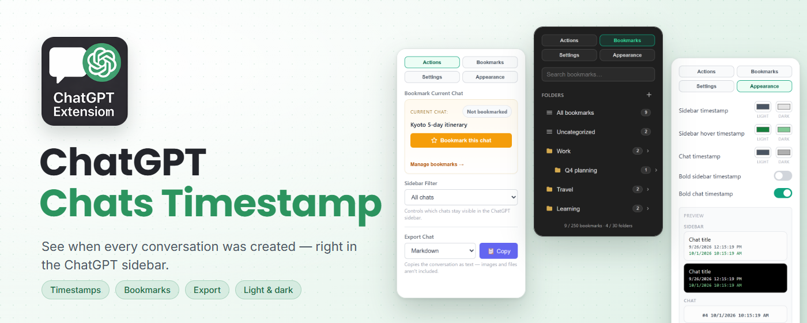
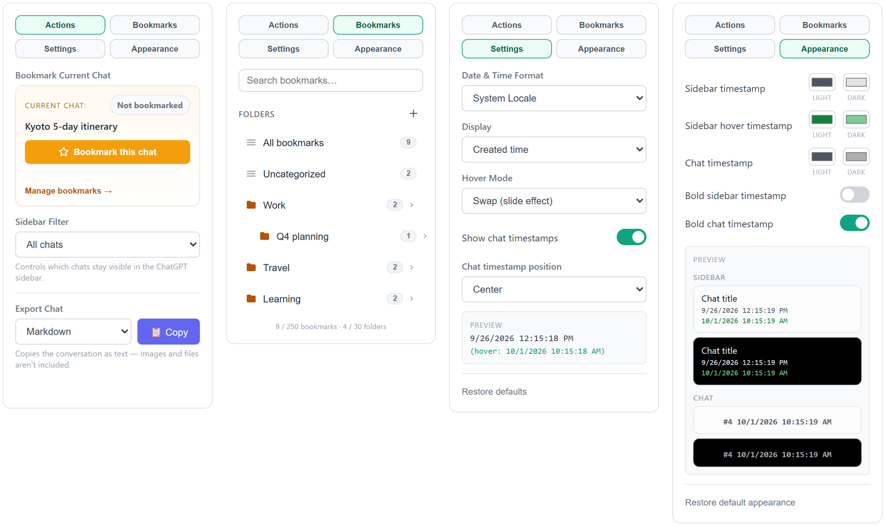

<!-- Translated from README.md. Keep the section order the same so the two files are easy to compare. -->

# ChatGPT Chats Timestamp

[English](README.md) · **繁體中文**

<a title="Users" target="_blank" href="https://chromewebstore.google.com/detail/chatgpt-chats-timestamp/fjfjjofbppklnihhhdfcojbdbghpolhm?hl=zh-TW"></a>
<a title="Version" target="_blank" href="https://chromewebstore.google.com/detail/chatgpt-chats-timestamp/fjfjjofbppklnihhhdfcojbdbghpolhm?hl=zh-TW"></a>
<a title="Latest release" target="_blank" href="https://github.com/eryet/chatgpt-chats-timestamp/releases/latest"></a>



**ChatGPT 對話時間戳**讓你直接在側邊欄看到每個 ChatGPT 對話的建立時間。它也會在每則訊息旁加上時間，讓你把對話加入書籤、整理到資料夾並加上備註，還能把整段對話複製到剪貼簿。

**[從 Chrome 線上應用程式商店安裝](https://chromewebstore.google.com/detail/chatgpt-chats-timestamp/fjfjjofbppklnihhhdfcojbdbghpolhm?hl=zh-TW)** · [下載發行版本](https://github.com/eryet/chatgpt-chats-timestamp/releases/latest)

## 功能

### 🕒 側邊欄時間戳

側邊欄的每個對話都會顯示建立時間，滑鼠懸停在對話上即可查看最後更新時間。你也可以改成預設顯示更新時間，並選擇懸停時的效果：

- **交換**：時間戳會滑動切換成另一個時間
- **傳統**：另一個時間會顯示在下方
- **停用**：懸停時不變化

### 💬 訊息時間戳

每則訊息都會顯示回合編號與送出時間，例如 `#4 2026/10/1 上午10:15:25`。可以放在靠左、置中或靠右，也可以關閉。時間來自 ChatGPT 已經載入的資料；如果拿不到時間，就會留白，不會用猜的。

### ⭐ 書籤

- 在彈出視窗中把目前開啟的聊天加入書籤，已加入書籤的聊天會在側邊欄顯示一顆小星星。
- 將書籤整理到資料夾，資料夾底下可再建立一層子資料夾。
- 為每則書籤加上最多 500 字的備註，記下這個對話為什麼重要。
- 搜尋範圍涵蓋標題與備註。
- 滑鼠移到書籤上即可刪除，也可以一次移除目前檢視中的所有書籤。
- 使用**側邊欄篩選**，讓 ChatGPT 側邊欄只顯示已加入書籤的聊天。

書籤儲存在 Chrome 同步儲存空間。如果開啟了 Chrome 同步功能，書籤會跟著你同步到其他電腦。最多可儲存 250 則書籤和 30 個資料夾，彈出視窗會顯示目前的使用量。

### 📋 匯出

將目前開啟的對話以 Markdown、純文字或 JSON 格式複製到剪貼簿。匯出只包含文字：圖片會變成 `[圖片]`，檔案會變成 `[檔案：檔名]`。

### 🎨 外觀

自訂側邊欄時間戳、側邊欄懸停時間戳與訊息時間戳的顏色，每一項都能分別為 ChatGPT 的淺色與深色主題設定顏色。你也可以把側邊欄或訊息時間戳設為粗體。即時預覽會同時呈現兩種主題下的效果。

### ⚙️ 設定

- **日期與時間格式**：系統語系、ISO、美式、歐式、英式、相對時間（「2 小時前」）、簡短、僅日期或僅時間
- **顯示**：建立時間或更新時間
- **懸停模式**：交換、傳統或停用
- **訊息時間戳**：開啟或關閉，以及靠左、置中或靠右

### 其他

- 支援專案中的聊天。
- 群組聊天同樣會顯示側邊欄時間戳，也能加入書籤和匯出。ChatGPT 本身已會在群組聊天中顯示訊息時間，所以擴充功能不會在那裡另外加上時間。
- 彈出視窗會跟隨瀏覽器的淺色或深色主題。
- 彈出視窗提供英文與繁體中文介面，會依瀏覽器語言自動切換。
- 擴充功能更新後，如果有已開啟的 ChatGPT 分頁仍在執行舊版本，彈出視窗會提醒你重新整理。

## 截圖

彈出視窗有四個分頁：**操作**、**書籤**、**設定**與**外觀**。下圖會配合你的 GitHub 主題顯示（截圖為英文介面）。

<picture>
  <source media="(prefers-color-scheme: dark)" srcset="screenshot/popup-tabs-dark.png">
  
</picture>

## 隱私權

- 唯一需要的權限是 `storage`，而且擴充功能只會在 `chatgpt.com` 與 `chat.openai.com` 上執行。
- 擴充功能本身不會發出任何網路請求。訊息時間是從 ChatGPT 已經載入的回應中讀取的，只會在記憶體中保留訊息 ID 與時間，絕不儲存訊息內容。
- 設定與書籤儲存在 Chrome 同步儲存空間。每則書籤包含聊天 ID、標題、資料夾、備註與日期。所有資料都不會傳送給開發者或任何其他伺服器。

## 安裝

### Chrome 線上應用程式商店（建議）

從 [Chrome 線上應用程式商店](https://chromewebstore.google.com/detail/chatgpt-chats-timestamp/fjfjjofbppklnihhhdfcojbdbghpolhm?hl=zh-TW)安裝，之後會自動更新。

### 手動安裝

1. 從[最新發行版本](https://github.com/eryet/chatgpt-chats-timestamp/releases/latest)下載 `chatgpt-chats-timestamp.zip` 並解壓縮，或是複製（clone）這個儲存庫：

   ```bash
   git clone https://github.com/eryet/chatgpt-chats-timestamp.git
   ```

2. 在 Chrome 中開啟 `chrome://extensions/`。
3. 開啟右上角的**開發人員模式**。
4. 點擊**載入未封裝項目**。
5. 選取解壓縮後的資料夾，或複製下來的儲存庫中的 `src` 資料夾。

## 使用方式

開啟 ChatGPT，時間戳就會自動出現，不需要任何設定。若要把目前的聊天加入書籤、匯出對話或調整設定，請點擊擴充功能圖示。如果想讓圖示一直顯示在工具列上，可以從 Chrome 的拼圖圖示選單中將它固定。

## 開發

```bash
npm ci
npm test
```

測試使用 jsdom，針對 ChatGPT 的各種頁面版面檢查擴充功能。ChatGPT 經常變更頁面，因此 [docs/compatibility.md](docs/compatibility.md)（英文）說明了如何在本機載入擴充功能、如何在正式網站上檢查，以及避免拖慢 ChatGPT 的規則。

## 參與貢獻

歡迎任何貢獻！歡迎開 issue 或送出 pull request。如果 ChatGPT 更新後有功能失效，請開 issue 並附上頁面類型（一般聊天、專案或群組聊天）以及你看到的狀況。

本 README 以英文版為主。如果發現中文版內容過時或有誤，也歡迎開 issue 或 PR。

延伸閱讀：[開發思路](https://gist.github.com/eryet/6242ca9013dea5fb37b27d05617bf1b9)（英文）

## 授權條款

本專案以 [MIT](LICENSE) 授權條款發布。
